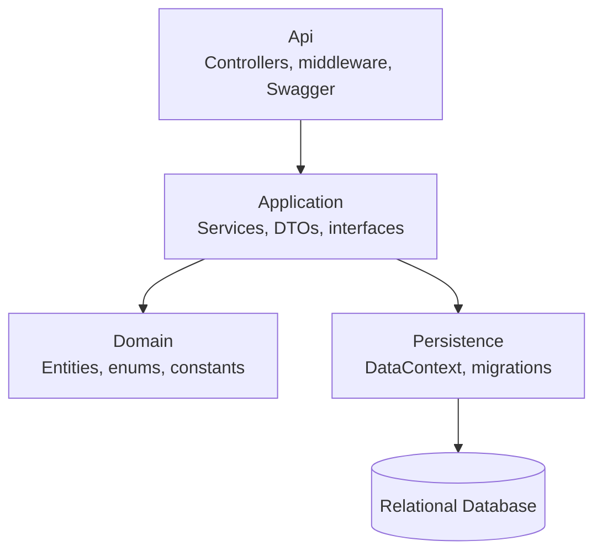
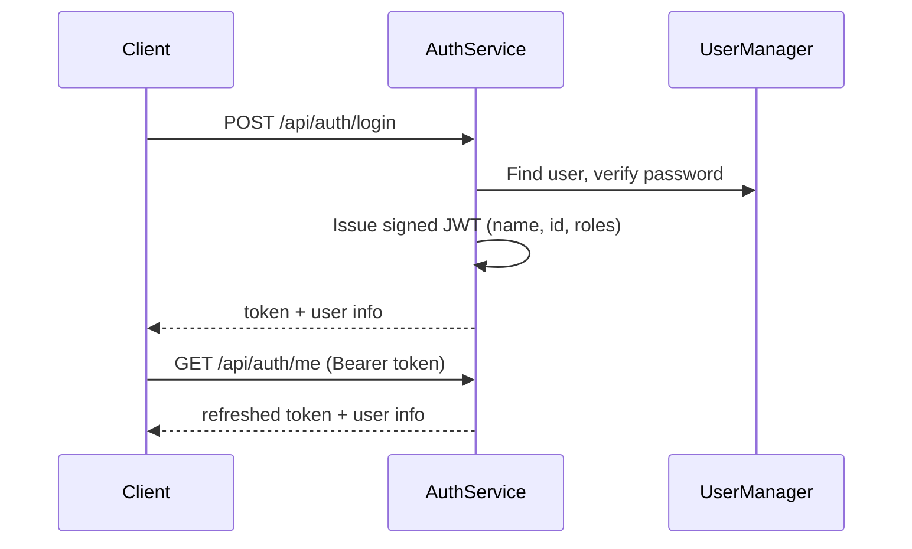
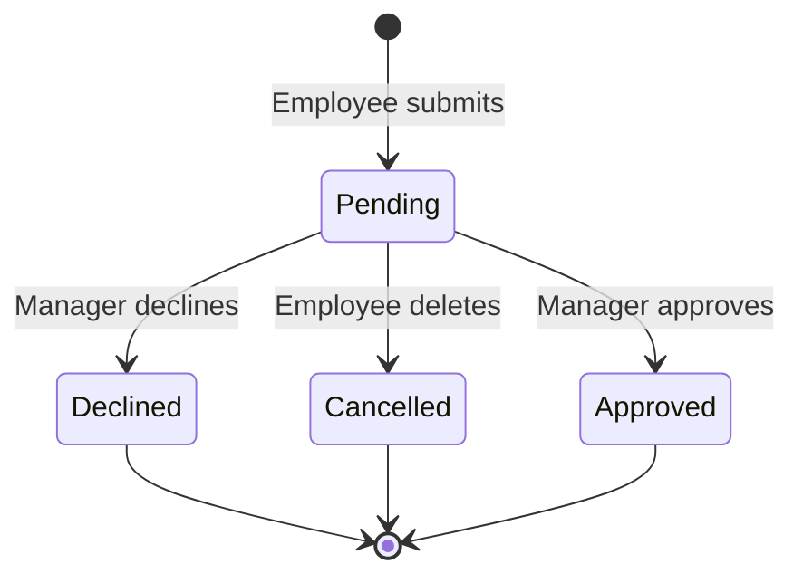
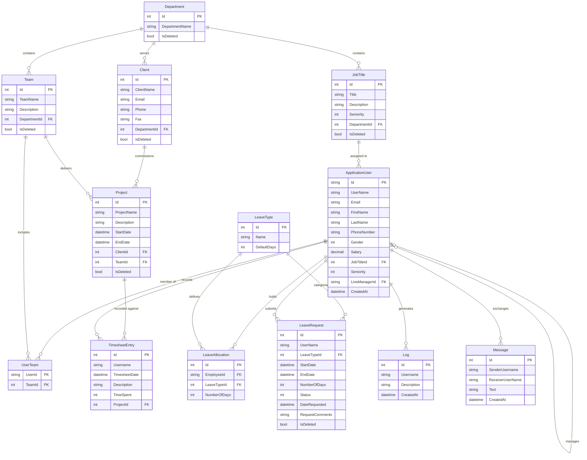

#NB I HAVE USED AI TO GENERATE THE FILE, SO SOME MIGHT BE A BIT MISALIGNING
# WorkForce Navigator

> A secure, role-based REST API for managing people, organisational structure, projects, timesheets and leave.


**Live API documentation:** [Swagger UI](http://workforcenavigatorexpress.runasp.net/swagger/index.html)

---

## Table of Contents

1. [Overview](#1-overview)
2. [Key Features](#2-key-features)
3. [Technology Stack](#3-technology-stack)
4. [Architecture](#4-architecture)
5. [Getting Started](#5-getting-started)
6. [Functional Specification](#6-functional-specification)
7. [Data Model](#7-data-model)
8. [API Reference](#8-api-reference)
9. [Security](#9-security)
10. [Testing](#10-testing)
11. [Deployment](#11-deployment)
12. [Known Limitations & Technical Debt](#12-known-limitations--technical-debt)
13. [Roadmap](#13-roadmap)
14. [Contributing](#14-contributing)
15. [Author](#15-author)

---

## 1. Overview

WorkForce Navigator centralises core HR and operational workflows behind a single API:

- **People and structure:** users, roles, departments, job titles and teams
- **Delivery:** clients, projects and project-based timesheets
- **Leave management:** allocations, requests and approvals
- **Collaboration and audit:** direct messaging and an activity log

Business rules are implemented in an application service layer, independent of the HTTP layer, following a clean, domain-driven structure. An Angular single-page application consumes the API.

**Access roles:** `OWNER` · `ADMIN` · `MANAGER` · `USER`

---

## 2. Key Features

| Module | Capabilities |
|---|---|
| Authentication | Registration, login, token refresh, role seeding and role management |
| User management | Profiles, job title and seniority assignment, team membership (maximum three teams) |
| Organisation | Departments, job titles, teams, clients and projects with soft delete |
| Timesheets | Daily entries per project, eight-hour daily limit, daily and weekly summaries |
| Leave | Per-type allocations, requests, approval workflow, upcoming leave view |
| Messaging | Direct user-to-user messages with receiver validation |
| Audit | Activity log per user and company-wide |

---

## 3. Technology Stack

| Concern | Technology |
|---|---|
| Runtime | .NET 9, ASP.NET Core Web API |
| Data access | Entity Framework Core (relational database) |
| Identity | ASP.NET Core Identity |
| Authentication | JWT Bearer, HMAC-SHA256, nine-hour expiry |
| Object mapping | AutoMapper |
| Result handling | FluentResults |
| API documentation | Swagger / OpenAPI 3.0 |
| Hosting | runasp.net |
| Client | Angular SPA (separate repository) |

---

## 4. Architecture

### 4.1 Layered Design



| Layer | Responsibility |
|---|---|
| Api | HTTP concerns: routing, authorisation attributes, serialisation |
| Application | Business rules, validation, orchestration, mapping |
| Domain | Core entities and enumerations; no external dependencies |
| Persistence | EF Core context, entity configuration, migrations |

### 4.2 Application Services

| Service | Responsibility |
|---|---|
| `AuthService` | Login, registration, JWT issuance, role seeding and updates |
| `UserService` | User profile retrieval and updates |
| `UserJobTitleService` | Job title queries and assignment |
| `DepartmentService` | Department membership listing |
| `TeamService` | Team management and membership rules |
| `ClientService` | Client details |
| `ProjectService` | Project management and validation |
| `TimesheetService` | Time entry, daily limit enforcement, summaries |
| `LeaveAllocationService` | Leave balances |
| `LeaveRequestService` | Leave request lifecycle |
| `MessageService` | Direct messaging |
| `LogService` | Audit logging |
| `GenericService<TEntity, TDto>` | Reusable CRUD, soft delete and paging |

### 4.3 Authentication Flow



### 4.4 Leave Request Lifecycle



Balance changes: days are reserved on submission and returned on decline or cancellation. See [section 12](#12-known-limitations--technical-debt) for items under correction.

### 4.5 Cross-Cutting Concerns

| Concern | Approach |
|---|---|
| Authentication and authorisation | JWT bearer with role claims |
| Soft delete | `IsDeleted` and `LastModified` managed through `GenericService` |
| Audit trail | `LogService` records key actions |
| Response contract | `GeneralServiceResponseDto` via `ResponseHelper` |

---

## 5. Getting Started

### 5.1 Prerequisites

- .NET 9 SDK
- A supported relational database (SQL Server or MySQL)
- Git

### 5.2 Installation

```bash
git clone <repository-url>
cd WorkForceNavigator
dotnet restore
```

### 5.3 Configuration

| Setting | Description |
|---|---|
| `ConnectionStrings:DefaultConnection` | Database connection string |
| `JWT:ValidIssuer` | Token issuer |
| `JWT:ValidAudience` | Token audience |
| `JWT:Secret` | Signing key (minimum 32 random characters) |

Store secrets outside source control:

```bash
dotnet user-secrets set "JWT:Secret" "<your-secret>" --project Api
dotnet user-secrets set "ConnectionStrings:DefaultConnection" "<connection-string>" --project Api
```

### 5.4 Database Migration

```bash
dotnet ef database update --project Persistence --startup-project Api
```

### 5.5 Run

```bash
dotnet run --project Api
```

Swagger UI is available at `https://localhost:<port>/swagger`.

### 5.6 Initial Setup

1. Seed roles: `POST /api/auth/seed-roles`
2. Ensure leave types exist (allocations are generated from each type's default days)
3. Register a user: `POST /api/auth/register`
4. Log in and use the returned token

```bash
curl -X POST "$BASE_URL/api/auth/login" \
  -H "Content-Type: application/json" \
  -d '{"username":"jdoe","password":"<password>"}'

curl "$BASE_URL/api/leave-allocations/mine" \
  -H "Authorization: Bearer <token>"
```

---

## 6. Functional Specification

### 6.1 Actors

| Actor | Description |
|---|---|
| Owner | Full control; role cannot be changed by others |
| Admin | Manages users, roles (User, Manager) and organisational data |
| Manager | Reviews and processes leave requests |
| User | Logs time, requests leave, sends messages |

### 6.2 Functional Requirements

| ID | Requirement |
|---|---|
| FR-01 | Users can register; the system assigns the User role and default leave allocations |
| FR-02 | Users can authenticate and receive a JWT valid for nine hours |
| FR-03 | Admins and Owners can change roles; Admins cannot modify Owners |
| FR-04 | Departments, job titles, teams, clients and projects support full CRUD with soft delete |
| FR-05 | Job titles can be assigned to users; seniority follows the job title |
| FR-06 | Users can belong to at most three teams |
| FR-07 | Timesheet entries are logged against projects, limited to eight hours per day |
| FR-08 | Daily and weekly timesheet summaries are available |
| FR-09 | Leave requests are validated for date, balance and overlap |
| FR-10 | Managers can approve or decline requests; users cannot process their own |
| FR-11 | Leave requests can be edited or cancelled with balance adjustment |
| FR-12 | Users can view their own allocations; privileged roles can view all |
| FR-13 | Users can exchange direct messages |
| FR-14 | Key actions are recorded in an audit log |

### 6.3 Business Rules

| ID | Rule |
|---|---|
| BR-01 | Leave must start after the current date |
| BR-02 | Requested days (inclusive) must not exceed the remaining balance for the leave type |
| BR-03 | A leave request must not overlap an existing request of the same user |
| BR-04 | Project end date must be after start date; name unique; client and team must exist |
| BR-05 | Team names are unique |
| BR-06 | Users cannot message themselves |
| BR-07 | A job title must belong to the selected department |
| BR-08 | Users cannot process their own leave request |

### 6.4 Non-Functional Requirements

| Area | Requirement |
|---|---|
| Security | Hashed credentials, signed tokens, role-based access, secrets held outside source control |
| Performance | Typical list endpoints respond within 500 ms; paging for large datasets |
| Reliability | Multi-step operations execute atomically |
| Maintainability | Layered architecture; services behind interfaces |
| Auditability | Key actions recorded with user and timestamp |
| Interoperability | OpenAPI 3.0 contract; CORS restricted to the client origin |

### 6.5 Out of Scope

Public holiday and weekend exclusion in leave calculation, email notifications, payroll, file attachments.

---

## 7. Data Model

The diagram below reflects the domain as implemented in the service layer.



| Entity | Notes |
|---|---|
| `ApplicationUser` | Extends the Identity user; seniority is derived from the assigned job title |
| `UserTeam` | Composite key; limited to three teams per user |
| `LeaveAllocation` | One row per user and leave type; `NumberOfDays` holds the remaining balance |
| `LeaveRequest` | `Status` values: Pending, Approved, Declined |
| `TimesheetEntry` | Daily total per user limited to eight hours |
| Soft delete | Applied through `IsDeleted` and `LastModified` |

Timesheet, leave request, log and message records reference users by username. Migration to `UserId` foreign keys is planned (see section 12).

---

## 8. API Reference

| | |
|---|---|
| Base URL | `http://workforcenavigatorexpress.runasp.net` |
| Interactive docs | `/swagger/index.html` |
| Authentication | `Authorization: Bearer <token>` on all endpoints except register, login and seed-roles |
| Content type | `application/json` |

**Standard response**

```json
{ "isSucceed": true, "statusCode": 200, "message": "Created Successfully" }
```

### 8.1 Auth

| Method | Endpoint | Description |
|---|---|---|
| POST | `/api/auth/seed-roles` | Create the four system roles |
| POST | `/api/auth/register` | Register a user and allocate leave |
| POST | `/api/auth/login` | Authenticate; returns token and user info |
| GET | `/api/auth/me` | Refresh token and user info |
| PATCH | `/api/auth` | Update a user's role |
| GET | `/api/auth/{username}` | Retrieve user details |
| GET | `/api/auth/jobtitle/{username}` | Retrieve a user's job title |

### 8.2 Users

| Method | Endpoint | Description |
|---|---|---|
| GET | `/api/users` | List users with roles, team and job title |
| GET | `/api/users/{username}` | User details |
| GET | `/api/users/extradetails/{username}` | Extended details |
| GET | `/api/users/usernames` | List usernames |
| GET | `/api/users/jobtitle/{username}` | User's job title |
| PATCH | `/api/users/{id}` | Update user details |

### 8.3 Departments

| Method | Endpoint | Description |
|---|---|---|
| GET | `/api/departments` | List |
| POST | `/api/departments` | Create |
| GET | `/api/departments/{id}` | Retrieve |
| PATCH | `/api/departments/{id}` | Update |
| DELETE | `/api/departments/{id}` | Soft delete |
| GET | `/api/departments/department-userdetails{id}` | Users with job title and team |

### 8.4 Job Titles

| Method | Endpoint | Description |
|---|---|---|
| GET | `/api/jobtitles` | List |
| POST | `/api/jobtitles` | Create |
| GET | `/api/jobtitles/{id}` | Retrieve |
| PATCH | `/api/jobtitles/{id}` | Update |
| DELETE | `/api/jobtitles/{id}` | Soft delete |
| GET | `/api/jobtitles/department/{departmentId}` | Filter by department and optional seniority |
| GET | `/api/jobtitles/{username}` | Retrieve for a user |
| POST | `/api/jobtitles/assign` | Assign to a user |

### 8.5 Teams

| Method | Endpoint | Description |
|---|---|---|
| GET | `/api/teams` | List active teams |
| POST | `/api/teams` | Create (unique name) |
| GET | `/api/teams/{id}` | Retrieve |
| PATCH | `/api/teams/{id}` | Update |
| DELETE | `/api/teams/{id}` | Soft delete |
| GET | `/api/teams/{userId}` | Teams for a user |
| GET | `/api/teams/{teamId}` | Members and projects of a team |
| POST | `/api/teams/addmember` | Add a member (maximum three teams per user) |
| POST | `/api/teams/remove-member` | Remove a member |
| GET | `/api/teams/available` | Teams by department |

### 8.6 Clients

| Method | Endpoint | Description |
|---|---|---|
| GET | `/api/clients` | List |
| POST | `/api/clients` | Create |
| GET | `/api/clients/{id}` | Details with department and projects |
| PATCH | `/api/clients/{id}` | Update |
| DELETE | `/api/clients/{id}` | Soft delete |

### 8.7 Projects

| Method | Endpoint | Description |
|---|---|---|
| GET | `/api/projects` | List with client and team |
| POST | `/api/projects` | Create |
| GET | `/api/projects/{id}` | Retrieve |
| PATCH | `/api/projects/{id}` | Update |
| GET | `/api/projects/{username}` | Projects for a user |

### 8.8 Timesheet

| Method | Endpoint | Description |
|---|---|---|
| POST | `/api/timesheet/create` | Add an entry (eight-hour daily limit) |
| GET | `/api/timesheet/by-date` | Entries for a date |
| GET | `/api/timesheet/weekly` | Current week, Monday to Friday |
| GET | `/api/timesheet/daily` | Daily hours and projects |
| GET | `/api/timesheet/week-off-set` | Weekly hours by week offset |

### 8.9 Leave Allocations

| Method | Endpoint | Description |
|---|---|---|
| GET | `/api/leave-allocations/all` | All allocations |
| GET | `/api/leave-allocations/mine` | Current user |
| GET | `/api/leave-allocations/username` | By username |
| GET | `/api/leave-allocations/leave-name` | By leave type |

### 8.10 Leave Requests

| Method | Endpoint | Description |
|---|---|---|
| POST | `/api/leave-requests/create` | Submit a request |
| GET | `/api/leave-requests/by-username` | By user |
| GET | `/api/leave-requests/mine` | Current user |
| GET | `/api/leave-requests/{requestId}` | Single request |
| PATCH | `/api/leave-requests/{id}` | Update dates and comment |
| POST | `/api/leave-requests/process` | Approve or decline |
| GET | `/api/leave-requests/upcoming` | Upcoming leave |
| DELETE | `/api/leave-requests/{leaveRequestId}` | Cancel and return days |

### 8.11 Messages and Logs

| Method | Endpoint | Description |
|---|---|---|
| POST | `/api/messages` | Send a message |
| GET | `/api/messages` | All messages |
| GET | `/api/messages/mine` | Current user's messages |
| GET | `/api/logs` | All logs |
| GET | `/api/logs/mine` | Current user's logs |

### 8.12 Status Code Conventions

| Code | Meaning |
|---|---|
| 200 / 201 | Success / created |
| 400 | Validation failure |
| 401 / 403 | Unauthenticated / forbidden |
| 404 | Resource not found |
| 409 | Conflict (duplicate or overlap) |
| 500 | Unhandled server error |

---

## 9. Security

| Area | Current implementation | Planned improvement |
|---|---|---|
| Credentials | Hashed by ASP.NET Identity | Password policy tuning and account lockout |
| Tokens | JWT HS256, nine-hour lifetime | Short-lived access token with refresh token |
| Secrets | Application configuration | Environment variables or secret vault |
| Authorisation | Role claims | Policy-based authorisation per endpoint |
| Sensitive data | Salary included in extended user details | Restrict to Admin and Owner |
| Messaging | Company-wide message listing endpoint | Restrict to Admin |
| Transport | Host-dependent | HTTPS only with HSTS |
| Input validation | DTO binding | FluentValidation and consistent 400 responses |

---

## 10. Testing

```bash
dotnet test
```

| Area | Scenarios |
|---|---|
| Authentication | Duplicate email, invalid credentials, expired token, Admin versus Owner role change |
| Teams | Fourth team rejected, duplicate membership, member removal |
| Timesheet | Eight-hour limit, split entries, week boundaries including Sunday |
| Leave | Insufficient balance, partial and enclosing overlaps, approval, decline refund, cancellation refund, self-approval blocked |
| Projects | End date before start, unknown client or team, duplicate name |
| Generic service | Soft delete, undo, ordered paging |

**Recommended tooling:** xUnit, EF Core SQLite or InMemory provider for service tests, `WebApplicationFactory` for integration tests.

---

## 11. Deployment

| Item | Detail |
|---|---|
| Hosting | runasp.net |
| Build | `dotnet publish Api -c Release -o ./publish` |
| Configuration | Connection string and `JWT__*` values set on the host |
| Database | Apply migrations before each release |
| CORS | Permit only the client application origin |

**Release checklist**

- [ ] Migrations applied
- [ ] Secrets set and rotated
- [ ] HTTPS enforced
- [ ] Swagger restricted in production
- [ ] Database backups enabled

---

## 12. Known Limitations & Technical Debt

Tracked items identified during code review, by priority.

### Priority 1: Data integrity and security

| # | Area | Issue | Resolution |
|---|---|---|---|
| 1 | Leave | Days are deducted on submission and again on approval | Deduct once; refund on decline or cancellation |
| 2 | Leave | Deletion is a hard delete without ownership check; refund ignores request status; success returns a failure payload | Soft delete, verify ownership, conditional refund, correct response |
| 3 | Leave | Balance changes span several saves | Execute in a single transaction |
| 4 | Leave | Update refunds old days but does not charge new days; availability check ignores leave type and the inclusive day | Recalculate by difference per leave type |
| 5 | Leave | Overlap check misses enclosing ranges and includes declined or deleted requests | `start <= end && end >= start`, exclude declined/deleted |
| 6 | Leave | Allocation lookup by username filters on first name | Filter on `UserName` |
| 7 | Auth | Duplicate-user response is created but not returned | Return the response |
| 8 | Auth | Role-update check compares OWNER twice | Correct role comparison |
| 9 | Auth | `FirstName` and `LastName` claims contain the username | Use actual names |
| 10 | Users | Salary exposed in user details | Restrict by role or use a separate DTO |

### Priority 2: Correctness and robustness

| # | Area | Issue | Resolution |
|---|---|---|---|
| 11 | Multiple | Casting a response object to `IEnumerable<T>` throws at runtime | Return an empty collection or handle in controller |
| 12 | Multiple | 404 returned for validation failures | Use 400, 409 or 404 as appropriate |
| 13 | Users | Blocking `.Result` calls and possible null dereferences | Async end to end, null checks, required includes |
| 14 | Users | Update returns an empty response | Return a success message |
| 15 | Timesheet | Week calculation returns next Monday on Sundays | `(7 + (int)day - 1) % 7` |
| 16 | Timesheet | Synchronous queries inside async methods | Use `SumAsync` and `ToListAsync` |
| 17 | Teams | Create ignores `DepartmentId` | Map the field |
| 18 | Teams | Ambiguous `{userId}` and `{teamId}` routes | Use distinct routes |
| 19 | Projects | Misleading duplicate message, dead code, listing ignores soft delete | Correct message, remove dead code, filter deleted |

### Priority 3: Maintainability

| # | Area | Issue | Resolution |
|---|---|---|---|
| 20 | GenericService | Swallowed exceptions, uninterpolated message strings, reflection-based soft delete, unordered paging | `ISoftDelete` interface, logging, ordered paging |
| 21 | Data model | Username-based references | Replace with `UserId` foreign keys |
| 22 | LogService | Saves changes internally, breaking transactional scope | Add to context; caller commits |
| 23 | Messaging | Global listing exposes all messages | Admin-only access |
| 24 | General | No paging, validation framework or global exception handling | Introduce all three |
| 25 | Timesheet | Hours stored as whole integers | Decimal hours or minutes |

---

## 13. Roadmap

| Phase | Focus |
|---|---|
| 1 | Resolve Priority 1 items; add transactions around leave operations |
| 2 | Global exception middleware, validation, correct status codes |
| 3 | `UserId` foreign keys, paging, filtering and sorting |
| 4 | Refresh tokens, policy-based authorisation |
| 5 | Automated test suite and CI pipeline |
| 6 | Weekend and public-holiday aware leave, email notifications |

---

## 14. Contributing

1. Create a branch from `main`: `feature/<name>` or `fix/<name>`
2. Keep each pull request focused on one change
3. Follow Conventional Commits (`feat:`, `fix:`, `docs:`, `refactor:`, `test:`)
4. Include tests with behavioural changes
5. Obtain a review before merging

---

## 15. Author

**Mduduzi Silinda**  
[GitHub](https://github.com/SilindamMN) · [LinkedIn](https://www.linkedin.com/in/silindam/)
